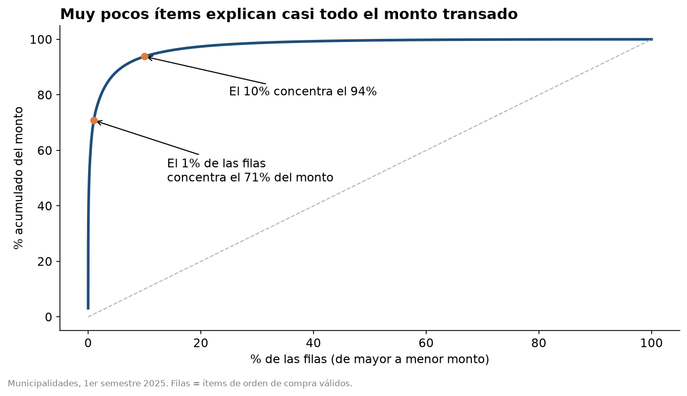
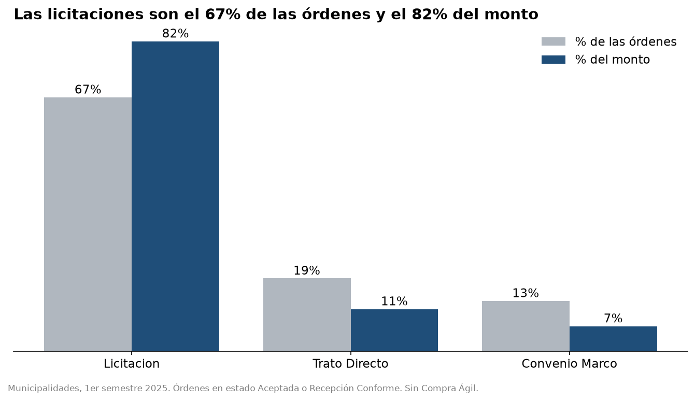
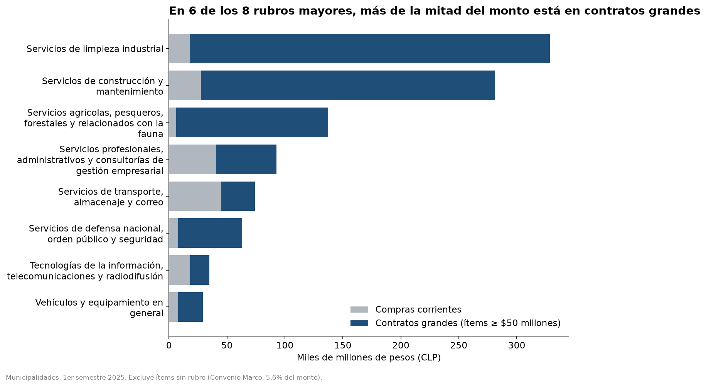
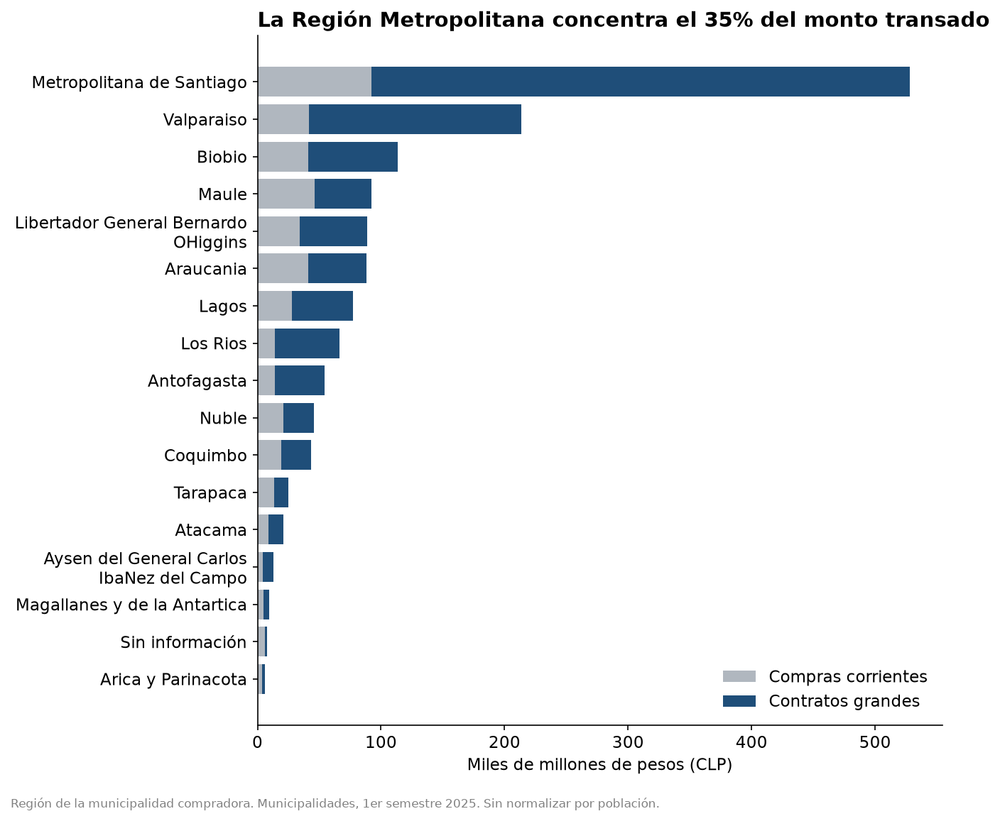
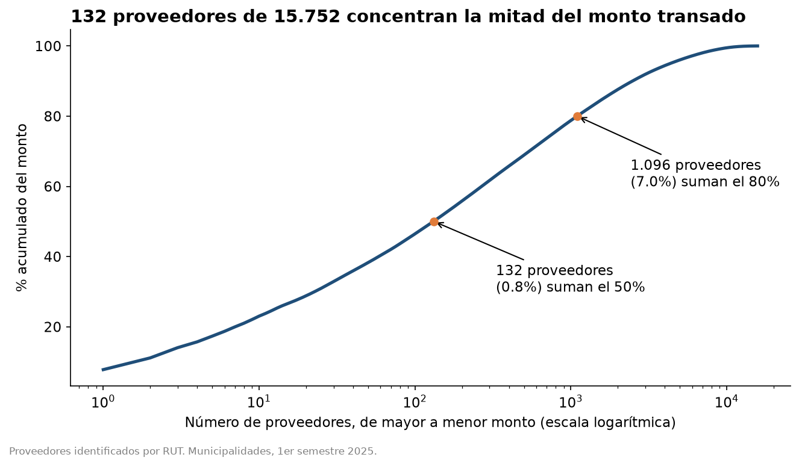
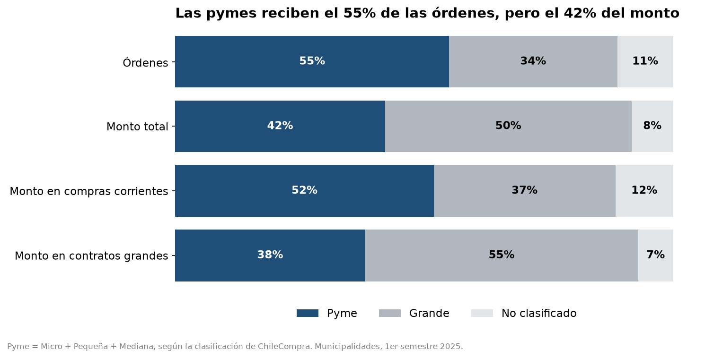
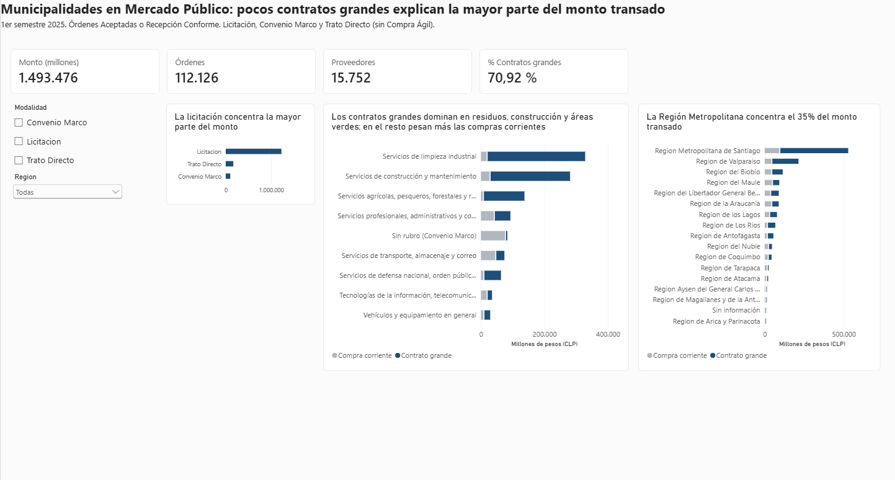
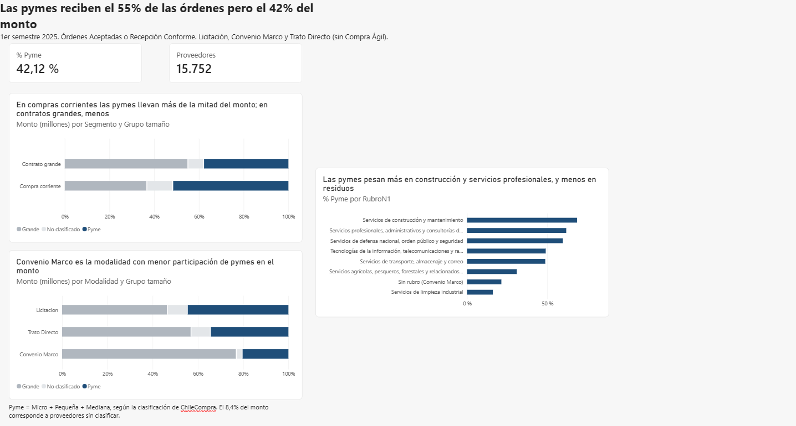

# Compras públicas municipales en Chile: ¿quién vende y cuánto se transa?

Análisis de las órdenes de compra de las municipalidades en Mercado Público (ChileCompra), primer semestre de 2025. Proyecto de punta a punta: datos crudos, limpieza y análisis en SQL, exploración y gráficos en Python, y un dashboard en Power BI.

**Herramientas:** Python (pandas, matplotlib) · SQLite · SQL (CTEs y funciones de ventana) · Power BI (DAX)

---

## Resumen de hallazgos

1. **Pocos contratos explican casi todo el monto.** El 1% de los ítems más grandes concentra el 70,8% del monto transado, y el 10% concentra el 93,8%.
2. **La licitación domina por monto.** Es el 67% de las órdenes y el 82% del monto. Pero esa dominancia viene de contratos grandes: en compras corrientes el reparto entre modalidades es mucho más parejo.
3. **Los rankings cambian según qué se mida.** Residuos, construcción y áreas verdes lideran por monto total porque viven de contratos gigantes; en el día a día lideran transporte y servicios profesionales.
4. **La Región Metropolitana concentra el 35% del monto**, y en 13 de las 16 regiones la mitad o más del monto está en contratos grandes.
5. **132 proveedores (0,8%) suman la mitad del monto.** Hay dos perfiles: proveedores con uno o pocos contratos gigantes, y proveedores recurrentes (combustible y gas) con miles de órdenes de monto menor.
6. **Las pymes reciben el 55% de las órdenes, pero el 42% del monto.** En compras corrientes llevan más de la mitad del monto (52%); en contratos grandes, el 38%.

---

## Preguntas que responde el proyecto

1. ¿Qué rubros y regiones concentran más monto?
2. ¿Qué tan concentrado está el monto en pocos proveedores?
3. ¿Cuánto pesan Trato Directo y Convenio Marco frente a la Licitación?
4. ¿Qué participación tienen las pymes y en qué rubros?

Importan porque las compras públicas mueven recursos de todos, y entender quién vende, dónde y bajo qué modalidad es la base para evaluar competencia y acceso de las pequeñas empresas.

---

## Los datos

- **Fuente:** [Datos Abiertos de ChileCompra](https://datos-abiertos.chilecompra.cl/descargas) > Descargas > Órdenes de compra > Sector del Estado: Municipalidades > 2025, primer semestre.
- **Modalidades incluidas:** Licitación, Convenio Marco y Trato Directo (363.914 filas, una por ítem de cada orden).
- **Por qué estos datos:** son reales, grandes y con los problemas de cualquier base de una organización (montos como texto, rubros vacíos, monedas mezcladas, ítems repetidos), lo que obliga a tomar decisiones de limpieza documentadas.
- **Compra Ágil** (archivo de ~4,3 GB) quedó fuera de esta versión. Ver "Limitaciones".

### Cómo reproducirlo

1. Descarga los archivos desde el enlace de arriba y descomprímelos en `data/raw/` (no se incluyen en el repositorio por su tamaño).
2. Instala las dependencias: `pip install pandas py7zr matplotlib seaborn plotly jupyter`
3. Ejecuta `notebooks/01_exploracion.ipynb` y luego `notebooks/02_graficos.ipynb`. Crean la base `data/chilecompra.db` y las imágenes de `docs/img/`.
4. Las consultas SQL están en `sql/`, numeradas en el orden del análisis.

---

## Metodología

Cada decisión de limpieza está documentada con su motivo en [`docs/decisiones.md`](docs/decisiones.md). Las más importantes:

- **Cada fila es un ítem, no una orden.** El monto de la orden se repite en cada ítem. El gasto se suma con el monto del ítem y las órdenes se cuentan con `COUNT(DISTINCT codigoOC)`. Sumar el monto de la orden habría inflado el resultado.
- **Monto válido:** órdenes en estado *Aceptada* o *Recepción Conforme*. Se midió la sensibilidad de incluir *Enviada a Proveedor* (la participación pyme baja de 42,1% a 39,7% y las conclusiones se mantienen).
- **Monedas:** se usan las columnas ya convertidas a pesos por ChileCompra, tras verificar que las tasas implícitas son coherentes.
- **Duplicados:** no se eliminan. La suma de ítems calza con el total de la orden en el 100% de los casos, así que son líneas repetidas del mismo producto y no errores de carga.
- **Valores extremos:** no se eliminan, porque casi todos son contratos reales (recolección de residuos, obras, áreas verdes) y representan la mayor parte del monto. En su lugar, se segmentan: **contrato grande** = ítem de $50 millones o más, y se reporta todo con y sin ellos. Se verificó con umbrales de $20, $50 y $100 millones (los contratos grandes concentran entre 63% y 80% del monto en todos los casos).
- **Un dato inválido excluido y documentado:** una orden de arriendo de casilleros marcada en UF con un monto equivalente a ~$27.400 millones, incoherente con su descripción de un arriendo mensual.
- **Métrica:** se habla de **monto transado**, no de gasto del semestre, porque algunas órdenes registran el valor total de contratos de varios años.
- **Rubro vacío:** el 99,5% de las filas de Convenio Marco no trae rubro ni código de producto. Esas filas (5,6% del monto) se analizan aparte, clasificadas por palabras clave del nombre del ítem, con una categoría "Sin clasificar" visible.
- **Pyme** = Micro + Pequeña + Mediana, según la clasificación de ChileCompra. Los proveedores "No clasificados" (8,4% del monto) se reportan aparte: la participación pyme está entre 42,1% y 50,5%.

Total analizado: **$1.493.476 millones** en **112.126 órdenes** de **15.752 proveedores** (RUT distintos).

---

## Hallazgos

El detalle completo, con cifras, está en [`docs/hallazgos.md`](docs/hallazgos.md).

### 1. El monto transado depende de muy pocos ítems



### 2. Licitación domina por monto



Los contratos grandes pesan distinto según la modalidad: son el 76% del monto de Licitación, el 61% del de Trato Directo y el 21% del de Convenio Marco. Trato Directo es 1 de cada 5 órdenes; sus 317 órdenes con ítems grandes suman el 61% de su monto. Los datos no permiten juzgar si cada trato directo estuvo justificado, solo medir cuánto pesan.

### 3. Los rubros cambian de lugar al excluir contratos grandes



Los nombres de rubro engañan: el 87,5% de "Servicios de limpieza industrial" es eliminación y tratamiento de desechos, el 87,3% de "Construcción y mantenimiento" es construcción de edificios, y el 97% de "Servicios agrícolas" es mantenimiento de áreas verdes.

### 4. La Región Metropolitana concentra el 35% del monto



La RM y el Maule tienen un número similar de órdenes (13.652 y 12.548), pero la RM transa 5,7 veces más monto: la diferencia está en el tamaño de los contratos. Tres órdenes de un mismo proveedor en la Municipalidad de Viña del Mar suman $86.847 millones, el 40,7% del monto de la región de Valparaíso.

### 5. Pocos proveedores concentran la mitad del monto



En compras corrientes (sin contratos grandes), los 10 mayores proveedores suman el 11,2% del monto y lideran los de combustible y gas. En el monto total, los 10 mayores suman el 23,0% y lideran las empresas de residuos y construcción.

### 6. Las pymes: más órdenes que monto



---

## Dashboard (Power BI)

Dos páginas con filtros por modalidad y región. Versión en PDF: [`docs/dashboard.pdf`](docs/dashboard.pdf).





El archivo del dashboard está en `dashboard/chilecompra.pbix` (requiere Power BI Desktop, gratuito en Windows).

---

## Recomendaciones

Si estuviera analizando esto para ChileCompra o para un municipio:

- **Medir por separado los contratos grandes y las compras corrientes.** Los indicadores agregados (promedios, rankings de monto) están dominados por unos pocos contratos y llevan a conclusiones engañosas sobre qué se compra realmente.
- **Revisar la clasificación de tamaño de proveedores en contratos grandes.** Una orden adjudicada a una empresa clasificada como mediana por ~$20.000 millones sugiere que el criterio o el año de referencia no está claro.
- **Completar el campo de rubro en Convenio Marco.** Hoy casi no viene poblado, lo que impide analizar por categoría una modalidad que mueve combustibles, gas y tecnología.
- **Mirar con más detalle el Trato Directo de gran monto**, en especial por rubro y proveedor, antes de sacar conclusiones sobre competencia.

---

## Limitaciones y próximos pasos

- **Alcance:** solo compras hechas vía Mercado Público (las empresas públicas no están obligadas a usarlo), un semestre y tres de las cuatro modalidades.
- **Compra Ágil no incluida.** Es la modalidad con más órdenes pequeñas, así que los porcentajes de órdenes por modalidad se refieren a las tres analizadas, no a todas las compras municipales.
- **Contratos de varios años:** una orden puede registrar el valor total de un contrato plurianual, lo que sobrerrepresenta el monto del semestre.
- **Clasificación de tamaño** tomada de ChileCompra sin poder verificarla (se desconoce el criterio y el año de referencia).
- **Sin normalizar por población:** las comparaciones entre regiones son en monto absoluto.
- **Clasificación por texto** de los ítems de Convenio Marco sin rubro: aproximada.
- **Próximos pasos:** incorporar Compra Ágil (procesándola por partes), sumar el dataset de licitaciones para medir plazos y cuellos de botella, normalizar por población con datos del INE, y analizar más de un semestre para ver la evolución.

---

## Estructura del repositorio

```
chilecompra-analisis/
├── dashboard/        # archivo .pbix de Power BI
├── docs/             # decisiones.md, hallazgos.md, dashboard.pdf e imágenes
│   └── img/
├── notebooks/        # exploración y gráficos en Python
├── sql/              # consultas numeradas en el orden del análisis
└── README.md
```

## Autor

**Benjamin Rojas Hernandez** · Ingeniero informático con interés en análisis de datos
[LinkedIn](https://cl.linkedin.com/in/benjamin-rojas-hernandez-b13a76252) · [Correo](mailto:rojasb308@gmail.com)
